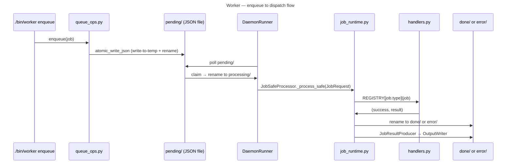

# Worker

Background job queue and daemon for deferred CLI tasks. Entry point: `./bin/worker`.

Supports `--agentic`: `./bin/worker --agentic --agentic-format yaml --agentic-compact`.

## Key Commands

```bash
./bin/worker enqueue --type run_cli --payload-json '{"cmd":["mail","labels","list"]}'
./bin/worker enqueue --type run_shell --payload-json '{"script":"..."}'
./bin/worker enqueue --type workflow_stage --payload-json '{...}'
./bin/worker daemon                  # run poll loop (default interval: 5s); drains and requeues running jobs on shutdown
./bin/worker run-once                # process up to N pending jobs once
./bin/worker list                    # show queue counts
./bin/worker status                  # detailed queue and worker summary
./bin/worker show <job-id>           # show job JSON
./bin/worker retry <job-id>          # requeue a single error job
./bin/worker requeue-errors          # move all error/ jobs back to pending/
./bin/worker purge                   # delete old done/error jobs and prune saved qwen responses
```

Job types: `run_cli` (allowlisted `./bin/` command), `run_shell` (allowlisted shell script), `workflow_stage` (workflow engine stage), `qwen_patch` (local Ollama-backed code-patch generation).

### qwen_patch job type

Enqueue via `./bin/qwen`; do not call `worker enqueue` directly for this type.

```bash
# Enqueue a patch job (Ollama must be running)
./bin/qwen patch --files src/foo.py src/bar.py --instruction "add type hints"
./bin/qwen patch --files src/foo.py --instruction "..." --model qwen2.5-coder:7b
./bin/qwen patch --files src/foo.py --instruction "..." --explain  # dry-run: run guards, skip model call

# After the job completes, print the git apply command for the stored patch
./bin/qwen --apply <job-id>          # prints: git apply <patch-file-path>

# Record or verify the pinned model digest
./bin/qwen pin-model                  # record running model digest
./bin/qwen pin-model --check          # compare recorded vs running; no write
```

Default model: `qwen2.5-coder:14b`. Patches are written to `core.paths.output_dir("qwen") / "patches"`. The handler never applies the patch — `--apply` only prints the `git apply` command for the caller to run.

Build/install workflow: `workflows/code/qwen-local-handler.yaml`. Day-to-day administration: `workflows/code/qwen-admin.yaml`. Minimal worked example: `workflows/demo/qwen-job-type.yaml`.

## Architecture



Jobs are file-based JSON under `QUEUE_ROOT`. Atomicity is via write-to-temp + rename. The daemon polls `pending/`, moves to `processing/` on claim, then to `done/` or `error/` on completion. `--max-inflight` caps concurrent processing jobs.

## Key Modules

- `cli.py` — CLIApp-based dispatch; `main()` calls `app.run()`, which catches `CLIError`, `KeyboardInterrupt`, and other exceptions via `handle_error()`
- `commands.py` — `EnqueueCommand`, `ListCommand`, `StatusCommand`, `ShowCommand`, `RequeueErrorsCommand`, `RetryCommand`, `PurgeCommand`
- `job_runtime.py` — `JobSafeProcessor(SafeProcessor)`, `JobResultProducer(BaseProducer)`, `WorkerConfig`, `JobContext`, `JobRequest`, `JobResult`; `DaemonRunner` poll loop
- `handlers.py` — `handle_run_cli`, `handle_run_shell`, `handle_workflow_stage`; `REGISTRY["qwen_patch"] = handle_qwen_patch`; allowlist enforced in `_is_allowed_bin` / `_shell_allowlist`
- `qwen.py` — `handle_qwen_patch`: SEARCH/REPLACE edit blocks, local difflib diff, `git apply --check`, never applies; memory precheck; `terminal-*` outcome strings
- `qwen_edits.py` — parse SEARCH/REPLACE blocks, apply to file contents in memory, build unified diff
- `qwen_telemetry.py` — telemetry for qwen job runs
- `queue_ops.py` — `enqueue`, queue file operations
- `queue.py` — queue directory layout and path resolution
- `queue_metrics.py` — throughput and performance metrics
- `_helpers.py` — `atomic_write_json`, `safe_load_json`, `get_worker_state_dir`, `log_perf_jsonl`

## Tests

`tests/worker_tests/`
